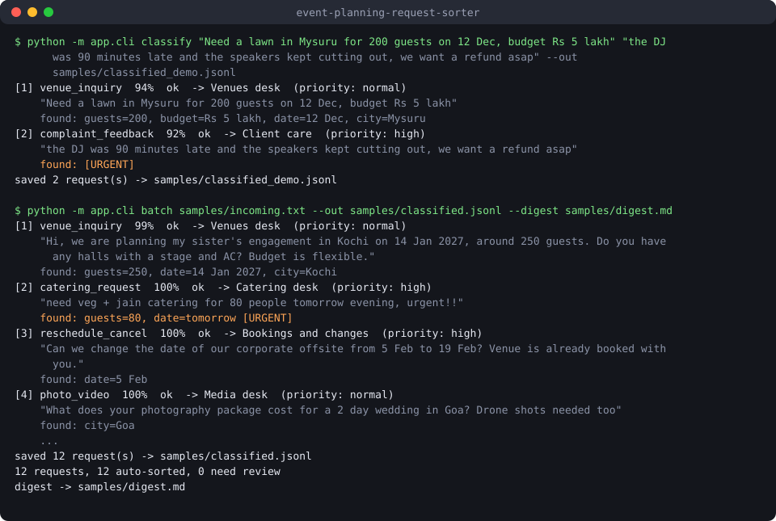

# Event Planning Request Sorter

[](https://ask.thili.ai/b/847m3z7jrr)
[](https://github.com/Sky00raider/event-planning-request-sorter/actions/workflows/ci.yml)

A tool for an event-planning company's inbox. Paste in a client message, or point it at a file of them, and it
decides which of 11 request types it is, how sure it is, which team should pick it up, and how urgent it is. It
also copies out the guest count, budget, date and city. Requests it is unsure about are marked **NEEDS REVIEW**
instead of being guessed, and your corrections go back into training. Under the hood: GPT-2 (124M) with one new
token per request type, fine-tuned with a hand-written LoRA adapter (0.24% of the weights, a 1.2 MB file) using the
Hugging Face `Trainer`.



_The picture above is generated by [scripts/render_demo.py](scripts/render_demo.py) from the real CLI's output._

> **Headline.** On 132 held-out requests in the training style, fine-tuned GPT-2 is **89.4% accurate** against
> **75.8%** for a Naive Bayes baseline and **56.1%** for keyword rules. On 55 deliberately messy requests (very
> short, multi-topic, different wording) it drops to **70.9%** (Naive Bayes 58.2%, keywords 56.4%). The review
> threshold the code calibrates is too lenient for those messy messages: see [what went wrong](#what-went-wrong-and-what-to-do-about-it).

## Quickstart (the trained adapter is in the repo)

```bash
python3.12 -m venv .venv && source .venv/bin/activate        # Windows: .venv\Scripts\activate
pip install -r requirements.txt
python -m app.cli classify "Need a lawn in Mysuru for 200 guests on 12 Dec, budget Rs 5 lakh"
```

The first run downloads GPT-2 (about 500 MB) from Hugging Face; everything else is in the repo. CPU is fine for
classifying: `--threads 2` limits CPU use when the machine is busy.

| Command | What it does |
|---|---|
| `python -m app.cli classify "text" "text"...` | classify requests given on the command line |
| `python -m app.cli chat` | type requests one per line, each is classified and saved; an empty line quits |
| `python -m app.cli batch samples/incoming.txt --digest samples/digest.md` | classify every request in a `.txt`, `.csv` or `.jsonl` file and write a hand-over sheet |
| `python -m app.cli review` | walk the NEEDS REVIEW requests, confirm or correct each one |
| `python -m app.cli digest --file outputs/classified.jsonl` | markdown digest grouped by team |
| `python -m app.cli train [--corrections data/corrections.jsonl]` | fine-tune again (use a GPU, see below) |

Every classify, chat and batch run saves to `outputs/classified.jsonl` (change it with `--out requests.csv`; a
`.csv` extension writes a spreadsheet-friendly file; `--no-save` skips saving).

## Real output

```text
$ python -m app.cli classify "Need a lawn in Mysuru for 200 guests on 12 Dec, budget Rs 5 lakh" "the DJ was 90 minutes late and the speakers kept cutting out, we want a refund asap"
[1] venue_inquiry  94%  ok  -> Venues desk  (priority: normal)
    "Need a lawn in Mysuru for 200 guests on 12 Dec, budget Rs 5 lakh"
    found: guests=200, budget=Rs 5 lakh, date=12 Dec, city=Mysuru
[2] complaint_feedback  92%  ok  -> Client care  (priority: high)
    "the DJ was 90 minutes late and the speakers kept cutting out, we want a refund asap"
    found: [URGENT]
saved 2 request(s) -> samples/classified_demo.jsonl
```

All 12 messages in [samples/incoming.txt](samples/incoming.txt) (written separately from the dataset) were sorted
as a person would sort them: [samples/classified.jsonl](samples/classified.jsonl) has the full records and
[samples/digest.md](samples/digest.md) the hand-over sheet. A saved record looks like this:

```json
{"received": "2026-11-20T17:38:27+00:00", "text": "Need a lawn in Mysuru for 200 guests on 12 Dec, budget Rs 5 lakh",
 "label": "venue_inquiry", "confidence": 0.9366, "needs_review": false, "runner_up": "guest_logistics",
 "team": "Venues desk", "priority": "normal",
 "details": {"guests": 200, "budget": "Rs 5 lakh", "budget_value": 500000.0, "currency": "INR", "date": "12 Dec", "city": "Mysuru", "urgent": false}}
```

## How it works (one section per milestone in [app/core.py](app/core.py))

1. **Request types and dataset.** 11 types: `venue_inquiry`, `catering_request`, `decor_design`,
   `entertainment_booking`, `photo_video`, `guest_logistics`, `quote_pricing`, `reschedule_cancel`,
   `general_planning`, `complaint_feedback` and `other` (off-topic, spam, sales pitches). Each type maps to the
   team that handles it. [data/requests.jsonl](data/requests.jsonl) has 737 short requests, balanced at 67 per type:
   40 train, 10 validation, 12 test and 5 **hard** each. The hard split is messy on purpose: 2-4 word messages
   ("DJ for friday?"), several topics in one message, misleading words. The data is synthetic (written for this
   project, not collected from real clients). `validate_dataset` checks for unknown labels and for the same text
   (ignoring case and punctuation) appearing in two splits.
2. **Extended tokenizer and model.** `<venue_inquiry>` and the other 10 labels are added as special tokens, so each
   type is exactly one token, and the embedding matrix grows by 11 rows. GPT-2 ties its output layer to its input
   embeddings, so a label's row is also what the last hidden state is scored against. Each new row starts as the
   average embedding of the label's words (" venue inquiry"), not as noise. A gradient mask keeps the 50,257
   original rows frozen.
3. **Training with the Hugging Face `Trainer`.** A training example is `request text <label>`; the loss is masked to
   the label position only, so the model learns to name the type, not to write requests. LoRA is written by hand
   (no `peft`): the attention `c_attn` layers are frozen and each gets `y = base(x) + (alpha/r)(xAᵀ)Bᵀ` with
   r=8, alpha=16, B starting at zero so training begins from exactly pretrained GPT-2. Trainable: 303,360 of
   124.7M parameters. 6 epochs, lr 1e-3, batch 8 (330 steps): **22 seconds on a Colab T4**. The adapter file holds
   only the LoRA matrices, the 11 label rows and the settings; it is merged into the weights at inference.
4. **Inference and CLI.** One forward pass scores only the 11 label tokens after `request text `; the answer is the
   highest-scoring one and the confidence is the softmax over the 11. The record adds team, priority and
   extracted details.
5. **Saving.** Appends to `.jsonl` or `.csv`. `batch` reads `.txt`, `.csv` or `.jsonl`.

## Beyond the brief

- **Confidence triage.** Below the threshold a request is NEEDS REVIEW with its runner-up type. The default
  threshold is calibrated on the validation split as the lowest confidence at which auto-accepted requests are 95%
  accurate (stored inside the adapter).
- **Detail extraction** ([extract_details](app/core.py)): guests, budget (Rs / ₹ / $ / lakh / k / crore), date
  (`12 Dec`, `15/02/2027`, `next saturday`, `tomorrow`), city and an urgency flag, all with plain regexes.
- **Routing and priority.** Every type maps to a desk; urgent requests, complaints and changes are `high`
  priority, off-topic is `low`.
- **Review loop that learns.** `review` shows each flagged request with the guess and runner-up (Enter accepts, a
  number picks another type, `s` skips, `q` quits). Answers are written back to the file and appended to
  `data/corrections.jsonl`, which `train --corrections` adds to the training data.
- **Digest.** `batch --digest` / `digest` writes a markdown hand-over sheet: urgent first, then one list per team,
  then what still needs a human.
- **Baselines and honest evaluation.** [scripts/evaluate.py](scripts/evaluate.py) compares the model against
  hand-written keyword rules and a numpy Naive Bayes on both the same-style test set and the hard set, and writes
  [results/results.md](results/results.md).

## Results

Full tables: [results/results.md](results/results.md) (machine-readable: `results/results.json`). One training run
(seed 0); validation accuracy 93.6%.

| Model | Test accuracy (132) | Test macro-F1 | Hard accuracy (55) | Hard macro-F1 |
|---|---|---|---|---|
| Keyword rules (ten-minute rules) | 56.1% | 0.549 | 56.4% | 0.554 |
| Naive Bayes (word + bigram) | 75.8% | 0.743 | 58.2% | 0.555 |
| **Fine-tuned GPT-2 + LoRA** | **89.4%** | **0.887** | **70.9%** | **0.708** |

How many requests can go through without a human, by review threshold:

| Threshold | Test: auto-sorted | accuracy of those | Hard: auto-sorted | accuracy of those |
|---|---|---|---|---|
| 0.0 | 100% | 89.4% | 100% | 70.9% |
| 0.5938 (calibrated) | 96.2% | 92.1% | 94.5% | 73.1% |
| 0.8 | 90.2% | 93.3% | 85.5% | 76.6% |
| 0.9 | 84.8% | 93.8% | 74.5% | 80.5% |
| 0.95 | 80.3% | 94.3% | 61.8% | 88.2% |

## What went wrong, and what to do about it

- **The calibrated threshold (0.594) barely filters anything on messy input.** It was set on the validation split,
  which is written in the same style as training, so validation confidence says little about messy real
  messages. On the hard set it still auto-sorts 94.5% of requests at 73.1% accuracy. Raising it to 0.95 trades
  coverage for accuracy (hard: 61.8% auto at 88.2%). For a real inbox, start around 0.9 (`Sorter(threshold=...)`)
  and tune it on real messages.
- **Very short messages are the main failure, and the model is confident about them.** "DJ for friday?" is
  predicted `other` at 98.7% confidence, "Airport pickup?" as `other` at 94.8%, "biryani for 50?" as
  `quote_pricing` at 93.7%. Confidence is not a safeguard against this kind of mistake. Cheap fixes not done here:
  put short messages through review regardless of confidence, or add short messages to the training data.
- **Mixed-intent messages follow the topic words, not the main ask**, for example a complaint that mentions a quote
  went to `quote_pricing` (83%), and an "we have no idea about anything, someone please help" message (really `general_planning`) went to
  `complaint_feedback` (98.8%).
- **`guest_logistics` is the weakest type on the test set** (F1 0.63) and `other` the weakest on the hard set
  (0.46). I did not investigate why.
- The hard set is hard for every model, not just GPT-2: the baselines drop to 56-58% there too, and fine-tuned
  GPT-2 keeps a 12-15 point lead over them.

## Limitations

- The data is synthetic and the 11 types are my own choice. Real client messages will differ; the test set is 132
  requests and the hard set 55, so expect several points of noise (about ±5 points on the test set and ±12 on the
  hard set, 95% binomial interval), and this is a single training run.
- Detail extraction is regex-only and takes the first match: for "from 5 Feb to 19 Feb" it reports `5 Feb`; "2 day"
  is not a guest count; only the 24 cities in the list are found; "today" or "tomorrow" anywhere in a message sets
  the urgent flag, even when it is not about the deadline.
- Priority comes from the type, so a thank-you note (`complaint_feedback` covers praise too) is marked `high`.
- Classification is one type per request; a message that asks for two things gets only one.
- English with a little Hinglish in the data; other languages and scripts were not tried.

## Retraining (a GPU makes it 22 seconds)

On a laptop CPU, training is slow because GPT-2 has 124M parameters; a free Colab T4 does it in under a minute.
Runtime, Change runtime type, T4 GPU, then:

```python
!git clone https://github.com/Sky00raider/event-planning-request-sorter
%cd event-planning-request-sorter
!pip install -q -r requirements.txt
!python scripts/run_all.py        # train, evaluate, render the demo
```

`scripts/run_all.py` runs `python -m app.cli train`, `scripts/evaluate.py` and `scripts/render_demo.py` in order and
leaves the adapter in `models/adapter.pt`.

## Tests

```bash
pytest -q
```

31 tests, grouped by milestone in [tests/test_core.py](tests/test_core.py), with no network and no downloads: they
run on a tiny random GPT-2 with a tokenizer built inline. They check, among other things, that the LoRA layer
starts as the pretrained model and merges exactly, that only the label rows get an embedding gradient, that a saved
adapter reloads to identical scores, and that the review loop writes its corrections. GitHub Actions runs them on
every push. Note that the tests run on the CPU only, so the GPU training path is verified by the Colab run, not by CI.

## Layout

```
app/core.py        all the logic, one section per milestone, plus evaluation
app/cli.py         the command-line interface
app/llm.py         from the starter (a chat helper for Ollama/Groq/Gemini); the sorter does not use it
app/storage.py     from the starter (a small JSON key-value store); the sorter does not use it
data/requests.jsonl   737 labelled requests (train / val / test / hard)
models/adapter.pt     the trained LoRA adapter and label rows (1.2 MB)
scripts/           evaluate.py, render_demo.py, run_all.py
results/           results.md, results.json, train_report.json
samples/           incoming.txt and the outputs the CLI produced for it
docs/demo.svg      terminal demo drawn from real CLI output
```

## Settings and secrets

`.env` is ignored by git and the sorter needs no keys. Never commit `.env` or paste a key into code.
